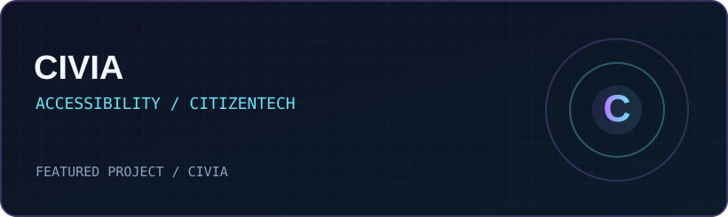
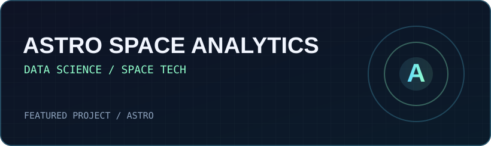
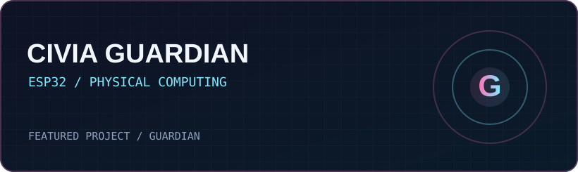
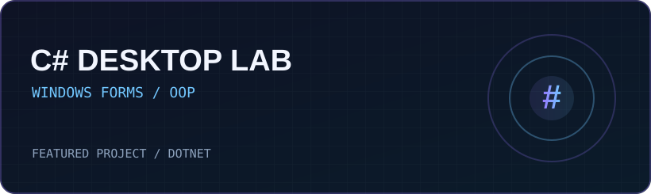

<div align="center">

<a href="https://portfolio-grl.vercel.app"></a>

<br/>


<br/>

[](https://portfolio-grl.vercel.app)
[](https://www.linkedin.com/in/guilherme-rodrigues-leite-0147a0248/)
[](mailto:guiroleite@gmail.com)
[](https://github.com/GuilhermeLeite20)


</div>

<br/>

## `> ./about_me --verbose` 👨‍💻

<table>
<tr>
<td width="66%" valign="top">

```ts
const guilherme = {
  name: "Guilherme Rodrigues Leite",
  location: "São Paulo, Brazil 🇧🇷",
  education: "Software Engineering @ FIAP",
  roles: ["Software Developer", "Data Engineer"],
  interests: ["Full Stack", "Automation", "Data", "AI"],
  philosophy: "Build useful things. Keep learning.",
};
```

I'm a **Software Engineering student at FIAP**, a software developer with professional experience across **back-end, front-end, automation, and data engineering**. I've helped build web applications, integrate APIs, automate workflows, and develop data pipelines.

My path has taken me through **Logymetria → eStracta → Santander Brasil**, connecting product engineering with data-driven decision-making. I enjoy turning complex problems into software that's useful, intuitive, and maintainable.

**Currently exploring:** applied AI, accessibility technology, full-stack architecture and data-intensive systems.

</td>
<td width="34%" align="center" valign="middle">

<a href="https://github.com/GuilhermeLeite20"></a>

**`CODE • CREATE • IMPROVE`**


</td>
</tr>
</table>

---

## `> ls ./tech-stack` ⚡

<div align="center">

**LANGUAGES**

[](https://skillicons.dev)

**FRAMEWORKS & FRONT-END**

[](https://skillicons.dev)

**DATA, DATABASES & ANALYTICS**

[](https://skillicons.dev)


**TOOLS, INFRASTRUCTURE & WORKFLOW**

[](https://skillicons.dev)


<sub>Technologies I've used professionally, academically, or in personal projects. Experience levels vary.</sub>

</div>

---

## `> cat ./featured-projects.md` 🚀

<div align="center">

<a href="https://civiaglass.vercel.app"></a>

**CIVIA · AI-powered accessibility concept**

Smart-glasses concept designed to support people with visual and hearing impairments through contextual assistance, accessible navigation and multimodal communication. My team's academic ecosystem explores the idea through connected prototypes.

[](https://civiaglass.vercel.app)
[](https://github.com/GuilhermeLeite20/Civia_CentralAcessibilidade)
[](https://github.com/GuilhermeLeite20/CIVIA-Guardian-IOT)

<br/>

<a href="https://github.com/GuilhermeLeite20/Astro_Space_Analytics"></a>

**ASTRO Space Analytics · Space data & predictive analytics**

Data preparation, exploratory analysis, predictive modeling and interactive visualizations for an academic space-data project. **Part of the team awarded 1st place in a FIAP Global Solution challenge.**

[](https://github.com/GuilhermeLeite20/Astro_Space_Analytics)
[](https://astrosafra.vercel.app/dashboard)

<br/>

<a href="https://github.com/GuilhermeLeite20/CIVIA-Guardian-IOT"></a>

**CIVIA Guardian · IoT assistive alerts**

An **ESP32 / Wokwi** academic prototype using a distance sensor and multimodal feedback (LEDs, buzzer and display). Demonstrates how proximity readings can be translated into accessible alerts. **Simulation / prototype, not a certified assistive device.**

[](https://github.com/GuilhermeLeite20/CIVIA-Guardian-IOT)
[](https://wokwi.com/projects/480814428340022273)
[](https://www.youtube.com/watch?v=OmLDChbnrTw)

<br/>

<a href="https://github.com/GuilhermeLeite20/Cafeteria_Dev"></a>

**Desktop Engineering Lab · C# / .NET / Windows Forms**

Desktop software built to practice **OOP, interfaces, business rules and local persistence**, including a coffee shop order management system and academic applications.

[](https://github.com/GuilhermeLeite20/Cafeteria_Dev)
[](https://github.com/GuilhermeLeite20/ProjetoEscola)
[](https://github.com/GuilhermeLeite20/CineCidade)

</div>

<details>
<summary><b>📦 More projects from the lab (click to expand)</b></summary>
<br/>

| Project | What it explores | Source |
|:--|:--|:--|
| 🎸 **Guitarmony** | Interactive guitar/music theory tooling · *private repository* | [Portfolio](https://portfolio-grl.vercel.app) |
| 🎪 **FestivalCidade** | Academic C# application | [Repository](https://github.com/GuilhermeLeite20/FestivalCidade) |
| 🚲 **LojaBike** | Bike store exercise | [Repository](https://github.com/GuilhermeLeite20/LojaBike) |
| ☕ **Coffe_System** | Java coffee system | [Repository](https://github.com/GuilhermeLeite20/Coffe_System) |
| 🧑‍💻 **Cafeteria_Dev** | Windows Forms order management | [Repository](https://github.com/GuilhermeLeite20/Cafeteria_Dev) |
| 🧩 **Civia Desk** | Desktop management of accessibility barriers and support points | [Repository](https://github.com/GuilhermeLeite20/Civia_CentralAcessibilidade) |

</details>

---

## `> git log --career --oneline` 🧭

<table>
<tr><th width="26%">Experience</th><th>What I worked on</th></tr>
<tr><td><b>Santander Brasil</b><br/><sub>Oct 2025 – Oct 2026</sub><br/><sub>Data Analysis & Engineering Intern</sub></td><td>Python data pipelines, scheduled Azure Databricks / Spark jobs, Oracle and MySQL queries, dashboards with Power BI and Databricks, and information quality for retail data.</td></tr>
<tr><td><b>eStracta</b><br/><sub>Mar 2024 – Aug 2025</sub><br/><sub>Junior Software Developer</sub></td><td>PHP/Laravel back-end development, automation bots in PHP/Python/JavaScript, REST APIs, PostgreSQL integrations, testing and technical documentation.</td></tr>
<tr><td><b>Logymetria</b><br/><sub>Oct 2023 – Mar 2024</sub><br/><sub>Front-End Developer & Technician</sub></td><td>React interfaces, an internal SaaS front end, responsive UI with Tailwind/Bootstrap, and technical customer support.</td></tr>
</table>

<div align="center">


</div>

---

## `> gh stats --live` 📊

<div align="center">

<a href="https://github.com/GuilhermeLeite20">
  
</a>
<a href="https://github.com/GuilhermeLeite20?tab=repositories">
  
</a>

<br/>


<br/>

<a href="https://github.com/GuilhermeLeite20"></a>

<sub>Live widgets are generated by third-party services and may occasionally be rate-limited. Language cards reflect public GitHub repository data, not overall proficiency.</sub>

</div>

---

## `> ./snake --eat-commits` 🐍

<div align="center">

<picture>
  <source media="(prefers-color-scheme: dark)" srcset="https://raw.githubusercontent.com/GuilhermeLeite20/GuilhermeLeite20/output/github-snake-dark.svg" />
  <source media="(prefers-color-scheme: light)" srcset="https://raw.githubusercontent.com/GuilhermeLeite20/GuilhermeLeite20/output/github-snake.svg" />
  
</picture>

<sub>Generated daily with GitHub Actions + <a href="https://github.com/Platane/snk">Platane/snk</a>. The snake appears after the workflow's first successful run.</sub>

</div>

---

## `> cat ./mission.txt` 💡

> **Engineering isn't just about writing code. It's about making something difficult feel simple, turning information into insight, and building technology that people can actually use.**

<div align="center">

**Let's build something worth shipping.**

[](https://portfolio-grl.vercel.app)
[](https://www.linkedin.com/in/guilherme-rodrigues-leite-0147a0248/)


<sub>Designed with intent. Built with curiosity. Updated with code. © Guilherme Leite</sub>

</div>
